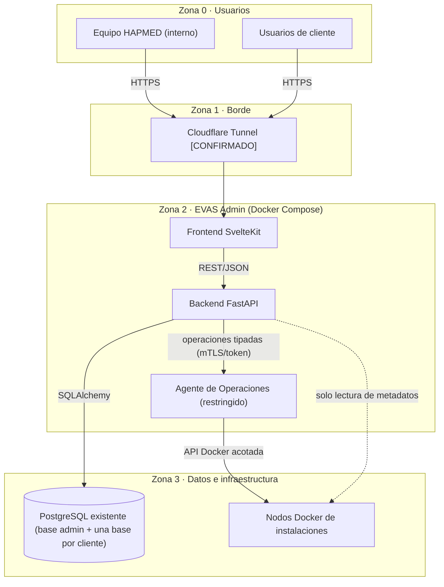
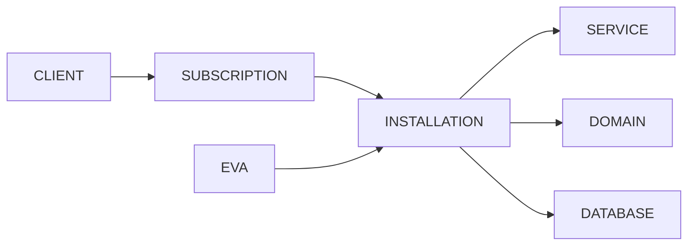
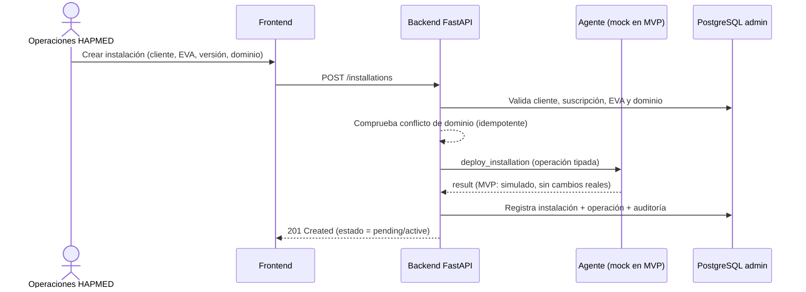

# ARCHITECTURE.md — Arquitectura de EVAS Admin

**Estado:** Aprobada en Fase 1. Decisiones clave cerradas
(ver [`DECISIONS.md`](./DECISIONS.md)).
**Documentos relacionados:** [`DATA_MODEL.md`](./DATA_MODEL.md),
[`API_CONTRACTS.md`](./API_CONTRACTS.md), [`SECURITY.md`](./SECURITY.md),
[`DOCKER_STANDARD.md`](./DOCKER_STANDARD.md).

## 1. Principios de arquitectura

1. **Simplicidad primero.** Monolito modular, no microservicios, en el MVP.
2. **Límites de confianza explícitos.** El panel nunca ejecuta Docker directo.
3. **Aislamiento multi-tenant.** Ningún dato de negocio cruza entre clientes.
4. **Seguro por defecto.** Mínimo privilegio, secretos fuera del código.
5. **Preexistente se respeta.** El PostgreSQL existente y los contenedores
   actuales no se crean, reinician ni modifican automáticamente.
6. **Operaciones tipadas.** Sin shell arbitrario expuesto a HTTP.

## 2. Diagrama de contexto y límites de confianza



**Fronteras de confianza:**

- **Z1→Z2:** terminación TLS y publicación. El acceso al panel requiere
  autenticación.
- **Z2 internia:** `FE` no habla nunca con Docker ni con la BD directamente;
  sólo con `API`.
- **Z2→Z3:** `API` sí puede leer la BD administrativa, pero **nunca** ejecuta
  comandos Docker. Sólo `AG` (agente) puede tocar Docker, y sólo mediante
  operaciones tipadas y autorizadas.
- **Sin acceso:** `/var/run/docker.sock` no se monta en `FE` ni en `API`.

## 3. Componentes

### 3.1 Frontend (SvelteKit + TypeScript)

- SPA/SSR de administración. Consume la API REST.
- Tailwind CSS para estilos.
- Responsive móvil/tablet/PC.
- Sin lógica de negocio sensible: sólo presentación y validación de formularios.

### 3.2 Backend (FastAPI)

- API REST versionada (`/api/v1`).
- Autenticación y autorización por rol/permiso.
- Lógica de dominio (clientes, suscripciones, instalaciones, etc.).
- Acceso a la BD administrativa vía SQLAlchemy; migraciones con Alembic.
- Emite **solicitudes de operación** al agente; no ejecuta Docker.
- Auditoría y alertas.

### 3.3 Agente de Operaciones (propio, separado y restringido)

- **Se construye como parte de este proyecto** (carpeta `agent/`), en su propio
  contenedor del Compose de EVAS Admin.
- Superficie mínima, operaciones **tipadas** (p. ej. `deploy_installation`,
  `upgrade_installation`, `restart_service`, `health_check`, `request_backup`,
  `request_restore`).
- Permisos mínimos sobre la API Docker; no acepta imágenes, puertos, montajes ni
  privilegios arbitrarios.
- Se autentica con el backend mediante **token/mTLS** y registra toda acción.
- **Modos:** `simulated` (no realiza cambios reales; para local/MVP) y `real`
  (requiere autorización humana y revisión de seguridad). El modo se elige por
  configuración de despliegue, **nunca** desde la interfaz.

### 3.4 PostgreSQL existente

- Aloja la **base administrativa** de EVAS (independiente de las bases de
  negocio de clientes).
- Tratado como recurso preexistente. Ver
  [`POSTGRES_EXISTING_INSTANCE.md`](./POSTGRES_EXISTING_INSTANCE.md).

## 4. Estructura de carpetas

### 4.1 Backend (propuesta)

```
backend/
├─ app/
│  ├─ main.py                # Bootstrap FastAPI
│  ├─ core/
│  │  ├─ config.py           # Settings desde variables de entorno
│  │  ├─ security.py         # Hashing, tokens, dependencias de auth
│  │  └─ logging.py          # Logging saneado
│  ├─ db/
│  │  ├─ base.py             # Declarative Base, engine, session
│  │  └─ session.py
│  ├─ models/                # Modelos SQLAlchemy (ver DATA_MODEL.md)
│  ├─ schemas/               # Pydantic (request/response)
│  ├─ api/
│  │  └─ v1/
│  │     ├─ router.py
│  │     └─ endpoints/       # Un módulo por dominio
│  ├─ services/              # Lógica de dominio
│  ├─ agents/                # Cliente del agente de operaciones + mock
│  └─ audit/                 # Registro de auditoría
├─ alembic/                  # Migraciones (no se ejecutan en prod sin autorización)
├─ tests/
├─ pyproject.toml
└─ Dockerfile
```

### 4.2 Frontend (propuesta)

```
frontend/
├─ src/
│  ├─ lib/
│  │  ├─ api/                # Cliente HTTP tipado
│  │  ├─ components/         # Tablas, filtros, diálogos, estados
│  │  ├─ stores/             # Estado de sesión y UI
│  │  └─ styles/             # Tailwind y tokens
│  ├─ routes/
│  │  ├─ (auth)/
│  │  ├─ dashboard/
│  │  ├─ clientes/
│  │  ├─ usuarios/
│  │  ├─ evas/
│  │  ├─ suscripciones/
│  │  ├─ instalaciones/
│  │  ├─ dominios/
│  │  ├─ bases-de-datos/
│  │  ├─ monitoreo/
│  │  └─ auditoria/
├─ static/
├─ svelte.config.js
├─ tailwind.config.js
└─ Dockerfile
```

### 4.3 Agente de Operaciones (propuesta)

```
agent/
├─ app/
│  ├─ main.py             # Servicio HTTP mínimo
│  ├─ config.py           # Modo simulated/real, credenciales Docker, token
│  ├─ auth.py             # Verificación token/mTLS del backend
│  ├─ operations/         # Handlers tipados (deploy, upgrade, restart, ...)
│  ├─ drivers/
│  │  ├─ docker_client.py # Acceso acotado a Docker (labels evas.managed_by)
│  │  └─ simulated.py     # Driver simulado (local/MVP)
│  └─ audit.py            # Registro de operaciones
├─ tests/
└─ Dockerfile
```

### 4.4 Gestión de datos (una base por cliente)

- **Base administrativa** (`evas_admin`): metadatos de EVAS Admin, en la
  instancia PostgreSQL existente.
- **Una base de negocio por cliente** (ADR-012): independiente entre clientes y
  de la administrativa. El backend resuelve credenciales por cliente desde el
  gestor de secretos; **nunca** se exponen al frontend.

## 5. Modelo de dominio (resumen)

Entidades separadas y relacionadas: **Cliente**, **Suscripción**, **EVA**,
**Instalación**, **Servicio/Contenedor**, **Dominio** y **Base de datos**, además
de usuarios, roles, auditoría y operaciones. Detalle en
[`DATA_MODEL.md`](./DATA_MODEL.md).



## 6. Autenticación y autorización (resumen)

- **Internos HAPMED:** roles Superadministrador, Operaciones, Atención al
  cliente y Solo lectura.
- **Usuarios de cliente:** roles separados de los internos.
- Autorización por **permiso** (no sólo por rol).
- **Dual (ADR-009):** cookie `HttpOnly`+`Secure`+`SameSite` con **CSRF** para la
  SPA, y **token** Bearer de alcance mínimo para integraciones y para el agente.
  Detalle en [`SECURITY.md`](./SECURITY.md).

## 7. Flujos principales

### 7.1 Alta de instalación nueva



### 7.2 Actualización controlada

```mermaid
sequenceDiagram
  actor Op as Operaciones HAPMED
  participant FE as Frontend
  participant API as Backend FastAPI
  participant AG as Agente (mock en MVP)
  participant PG as PostgreSQL admin

  Op->>FE: Solicitar actualización a versión aprobada
  FE->>API: POST /installations/{id}/upgrade
  API->>API: Valida versión permitida y permisos
  API->>PG: Registra solicitud de operación (auditoría)
  API->>AG: upgrade_installation(target_version)
  AG->>AG: (MVP) simulacro; (real) aplica política de backup
  AG-->>API: result + healthcheck
  API->>PG: Registra resultado, versión instalada, alertas
  API-->>FE: Estado final + eventos
```

## 8. Observabilidad, backups y pruebas

**Observabilidad**
- Logs estructurados y **saneados** (sin secretos) con retención y rotación
  definidas ([`OPERATIONS.md`](./OPERATIONS.md)).
- Endpoints de salud: `/healthz` (liveness) y `/readyz` (readiness) sin filtrar
  secretos.
- Métricas por instalación si el agente las provee (CPU/RAM).
- Alertas configurables (vencimientos, healthcheck fallido, backup ausente).

**Backups y recuperación**
- Backups por base (administrativa y una por cliente) según política
  ([`OPERATIONS.md`](./OPERATIONS.md)).
- Restauración auditada y con confirmación; rollback documentado.

**Pruebas (ADR-015)**
- Backend: `pytest` (unitarias + API con `TestClient`), aislamiento
  multi-tenant, migraciones en base efímera, contrato del agente (mock) e
  idempotencia.
- Frontend: `svelte-check` (tipos), `vitest` (unidades) y lint.
- CI: lint + typecheck + tests **antes** del build de imágenes.

## 9. Riesgos y mitigaciones

| Riesgo | Mitigación |
|--------|-----------|
| Exposición accidental del socket Docker | Nunca montarlo en API/FE; sólo agente restringido. |
| Fuga de secretos en logs | Logging saneado, revisión, `.env` fuera de Git. |
| Mezcla de datos entre clientes | Filtro por tenant obligatorio + pruebas de aislamiento. |
| Impacto sobre PostgreSQL existente | Sólo lectura de metadatos; sin DDL sin autorización. |
| Ejecución de comandos arbitrarios | Operaciones tipadas con parámetros validados. |

## 10. Pendientes de confirmación

- Detalles y permisos reales de la instancia PostgreSQL existente
  ([`POSTGRES_EXISTING_INSTANCE.md`](./POSTGRES_EXISTING_INSTANCE.md)).
- Gestor de secretos definitivo (env vs Vault) y mapa de conexiones por cliente.
- Canal de notificación de alertas e incidentes.
- ¿Los usuarios de cliente acceden al panel o es sólo interno?
