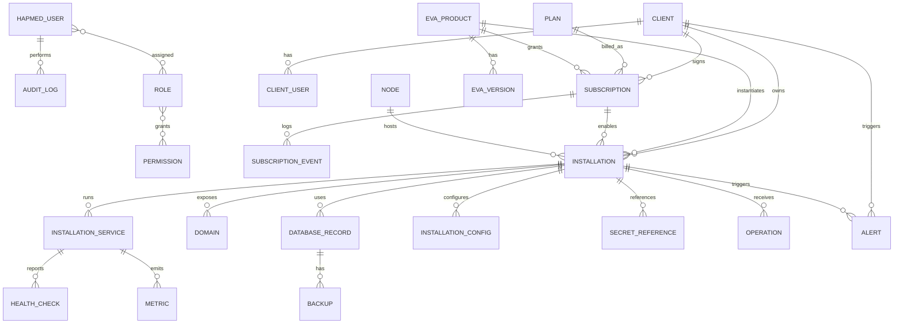
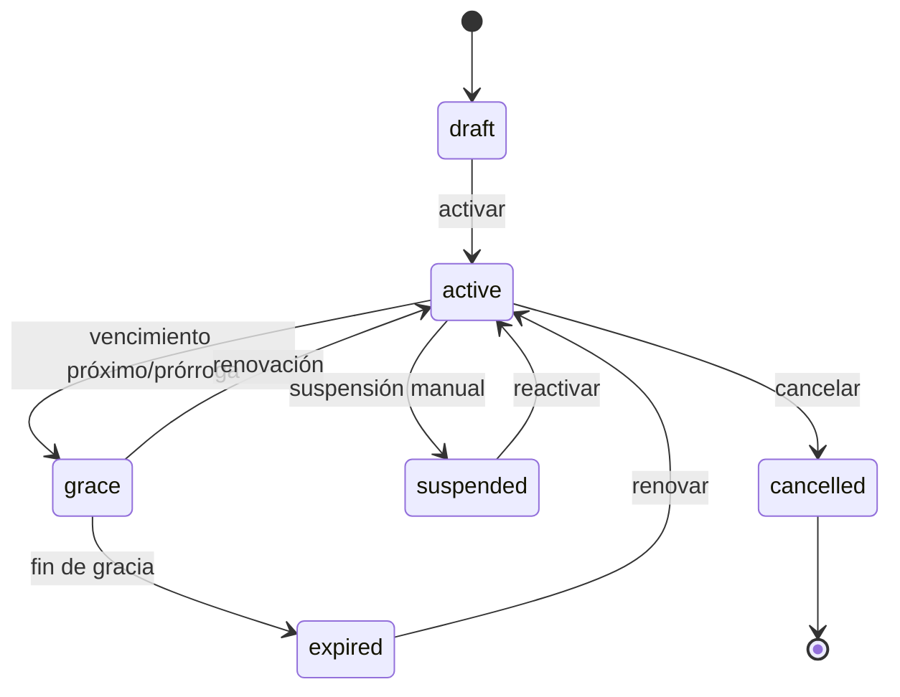

# DATA_MODEL.md — Modelo de datos de EVAS Admin

**Estado:** Borrador inicial para revisión.
**Base de datos:** PostgreSQL (instancia existente) — base administrativa
independiente de las bases de negocio de clientes.
**ORM:** SQLAlchemy 2.x · Migraciones: Alembic (no se ejecutan en prod sin
autorización).
**Documentos relacionados:** [`ARCHITECTURE.md`](./ARCHITECTURE.md),
[`API_CONTRACTS.md`](./API_CONTRACTS.md), [`SECURITY.md`](./SECURITY.md).

## 1. Principios de modelado

1. **Entidades separadas.** Cliente ≠ Suscripción ≠ EVA ≠ Instalación ≠
   Servicio ≠ Dominio ≠ Base de datos.
2. **Aislamiento por tenant.** Toda entidad de negocio ligada a un cliente lleva
   `client_id` y se filtra siempre por él.
3. **Borrado lógico.** Se usa `status`/`archived_at`, no borrado físico de
   registros de negocio.
4. **Fechas en UTC.** Todas las marcas temporales son `timestamptz` (UTC).
5. **Sin secretos.** No se almacenan contraseñas de bases de negocio ni claves;
   sólo **referencias** a secretos (`SECRET_REFERENCE`).
6. **Convenciones:** tablas en `snake_case` plural, PK `id` (UUID), `created_at`,
   `updated_at`.

## 2. Diagrama entidad-relación

## 3. Entidades y campos principales

### 3.1 Usuarios y seguridad

**HAPMED_USER** (usuarios internos)
| Campo | Tipo | Notas |
|-------|------|-------|
| id | uuid PK | |
| email | string UNIQUE | |
| password_hash | string | hash seguro; nunca texto plano |
| full_name | string | |
| is_active | boolean | desactivación en lugar de borrado |
| mfa_enabled | boolean | [PROPUESTA] |
| last_login_at | timestamptz | |
| created_at / updated_at | timestamptz | UTC |

**ROLE** · `id`, `code` (UNIQUE), `name`, `description`, `is_system`.
Códigos internos sugeridos: `superadmin`, `operations`, `customer_care`, `read_only`.

**PERMISSION** · `id`, `code` (UNIQUE), `description`.
Ejemplos: `clients:write`, `installations:upgrade`, `backups:request`, `users:manage`.

**ROLE_PERMISSION** · `role_id`, `permission_id`.
**HAPMED_USER_ROLE** · `user_id`, `role_id`.

> Regla: autorización por **permiso**, no sólo por rol. Prohibida la
> autoelevación de privilegios.

**CLIENT_USER** (usuarios de cliente)
| Campo | Tipo | Notas |
|-------|------|-------|
| id | uuid PK | |
| client_id | uuid FK → CLIENT | aislamiento |
| email | string | UNIQUE por cliente [POR VERIFICAR] |
| password_hash | string | |
| role_code | string | roles de cliente, separados de los internos |
| is_active | boolean | |
| created_at / updated_at | timestamptz | |

### 3.2 Clientes y catálogo

**CLIENT**
`id`, `legal_name`, `display_name`, `tax_id` [POR VERIFICAR si aplica],
`status` (`active`/`suspended`/`archived`), `notes`, `archived_at`,
`created_at`, `updated_at`.

**EVA_PRODUCT**
`id`, `code` (UNIQUE, identificador estable), `name`, `description`,
`status` (`active`/`deprecated`), `created_at`, `updated_at`.

**EVA_VERSION**
`id`, `eva_product_id` FK, `version` (semver), `status`
(`approved`/`deprecated`/`blocked`), `deployment_requirements` (JSON),
UNIQUE(`eva_product_id`, `version`).

> Regla: el usuario sólo puede elegir EVA y versiones **registradas y aprobadas**.
> Nunca imágenes Docker ni parámetros arbitrarios.

### 3.3 Planes y suscripciones

**PLAN**
`id`, `code` (UNIQUE), `name`, `billing_period` (`monthly`/`quarterly`/`yearly`),
`price` numeric [PROPUESTA], `currency` [POR VERIFICAR], `is_active`.

**SUBSCRIPTION**
| Campo | Tipo | Notas |
|-------|------|-------|
| id | uuid PK | |
| client_id | uuid FK | |
| plan_id | uuid FK | |
| eva_product_id | uuid FK | |
| status | enum | ver transiciones |
| start_date | date/timestamptz | |
| renewal_date | timestamptz | |
| end_date | timestamptz | vencimiento |
| auto_renew | boolean | [PROPUESTA] |
| created_at / updated_at | timestamptz | |

**Estados de suscripción y transiciones válidas:**

> Regla: **no** se suspenden ni borran instalaciones automáticamente sin política
> aprobada. Los pagos reales están fuera de alcance en esta fase.

**SUBSCRIPTION_EVENT** (historial)
`id`, `subscription_id` FK, `event_type`, `from_status`, `to_status`,
`occurred_at`, `actor_id`, `notes`.

### 3.4 Infraestructura e instalaciones

**NODE** (nodo/servidor Docker)
`id`, `name`, `host_ref` (referencia lógica, no IP real en docs),
`environment` (`prod`/`staging`), `status`, `created_at`.

**INSTALLATION**
| Campo | Tipo | Notas |
|-------|------|-------|
| id | uuid PK | |
| client_id | uuid FK | |
| eva_product_id | uuid FK | |
| subscription_id | uuid FK | |
| node_id | uuid FK | |
| environment | enum | |
| status | enum | `pending`/`deploying`/`active`/`degraded`/`stopped`/`failed`/`archived` |
| desired_version | string | versión objetivo |
| installed_version | string | versión en ejecución |
| last_operation_at | timestamptz | |
| created_at / updated_at | timestamptz | |

**INSTALLATION_SERVICE** (contenedor/servicio)
`id`, `installation_id` FK, `service_name`, `container_ref` (referencia lógica),
`image_ref` (referencia a EVA_VERSION, no arbitraria), `status`,
`health_status`, `last_checked_at`.

**DOMAIN**
`id`, `installation_id` FK, `fqdn`, `kind` (`primary`/`alias`),
`status` (`pending`/`active`/`conflict`), `created_at`.
Regla: conflicto de dominio detectado antes de activar.

**DATABASE_RECORD** (metadatos, no credenciales)
`id`, `installation_id` FK, `engine` (`postgresql`), `logical_name`,
`host_ref`, `status`, `last_backup_at`, `created_at`.
> Nunca se exponen credenciales. Aislamiento respecto a la base administrativa.

**INSTALLATION_CONFIG**
`id`, `installation_id` FK, `config_json` (validado contra esquema permitido de
la EVA), `schema_version`, `updated_at`.

**SECRET_REFERENCE** (referencia, no valor)
`id`, `installation_id` FK, `key`, `provider`, `path`, `created_at`.
> Almacena **dónde** está el secreto (p. ej. variable de entorno), nunca el valor.

### 3.5 Operaciones, monitoreo y auditoría

**OPERATION** (solicitud/ejecución de operación tipada)
`id`, `installation_id` FK, `type`
(`deploy`/`upgrade`/`restart`/`health_check`/`backup`/`restore`),
`requested_by` (HAPMED_USER), `status`
(`requested`/`running`/`succeeded`/`failed`/`cancelled`), `requested_at`,
`started_at`, `finished_at`, `result_summary`, `error_code`.

**AUDIT_LOG**
`id`, `actor_type` (`hapmed_user`/`system`), `actor_id`, `action`,
`entity_type`, `entity_id`, `metadata_json` (saneado, sin secretos),
`created_at`.

**ALERT**
`id`, `type` (`subscription_expiring`/`health_degraded`/`backup_missing`/...),
`severity` (`info`/`warning`/`critical`), `entity_type`, `entity_id`, `status`
(`open`/`acknowledged`/`resolved`), `created_at`, `resolved_at`.

**BACKUP**
`id`, `database_record_id` FK, `type` (`full`/`incremental`), `status`,
`started_at`, `finished_at`, `location_ref` (referencia lógica, no ruta real
sensible), `size_bytes`.

**HEALTH_CHECK**
`id`, `installation_service_id` FK, `status` (`healthy`/`unhealthy`/`unknown`),
`checked_at`, `latency_ms`.

**METRIC** (si el agente provee métricas fiables)
`id`, `installation_service_id` FK, `metric_type` (`cpu`/`ram`), `value`,
`captured_at`.

### 3.6 Integraciones y tokens

**API_TOKEN** (acceso máquina-a-máquina; ADR-009)
`id`, `name`, `owner_type` (`integration`/`agent`), `scopes` (lista de permisos),
`token_hash` (hash; **nunca** el valor en claro), `status`
(`active`/`revoked`), `last_used_at`, `expires_at`, `created_at`.
> Sólo se almacena el **hash** del token. La rotación y revocación se auditan.

## 4. Reglas de aislamiento multi-tenant

- Toda consulta de entidades de negocio incluye filtro por `client_id`.
- Los endpoints verifican que el actor tiene acceso al cliente objetivo.
- Pruebas automatizadas de aislamiento entre clientes son obligatorias
  ([`IMPLEMENTATION_PLAN.md`](./IMPLEMENTATION_PLAN.md)).

## 5. Estrategia de aislamiento de datos de negocio

**Confirmado (ADR-012):** **una base de datos por cliente** (PostgreSQL),
independiente entre clientes y de la base administrativa de EVAS.

- La base administrativa (`evas_admin`) guarda **sólo metadatos**.
- Cada cliente tiene su propia base de negocio; el backend resuelve su conexión
  por cliente desde el gestor de secretos.
- La base administrativa de EVAS **siempre** está separada de las bases de
  negocio. No se crean bases reales sin autorización
  ([`POSTGRES_EXISTING_INSTANCE.md`](./POSTGRES_EXISTING_INSTANCE.md)).
- Gestión de conexiones (pooling), roles, respaldos y límites por base se
  detallan en [`OPERATIONS.md`](./OPERATIONS.md) y [`ARCHITECTURE.md`](./ARCHITECTURE.md).

## 6. Índices y rendimiento (propuesta)

- Índices por FK más consultadas (`installation_id`, `client_id`,
  `subscription_id`).
- Índice único en `DOMAIN.fqdn` (activo).
- Índices por `created_at` en `AUDIT_LOG`, `OPERATION`, `ALERT`.
- Retención/particionado de `AUDIT_LOG` y `METRIC` [PROPUESTA].

## 7. Pendientes de confirmación

1. ¿`CLIENT_USER` accede al panel o es sólo entidad de negocio?
2. Moneda/impuestos de `PLAN` (fuera de alcance en MVP).
3. Política de retención de auditoría y métricas.
4. Convención de nombres físicos de las bases de negocio por cliente. [POR VERIFICAR]
