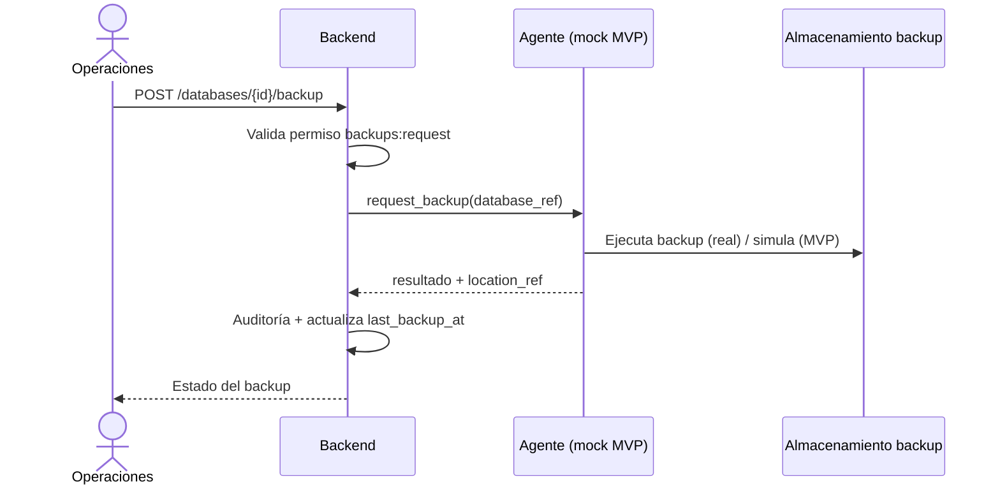
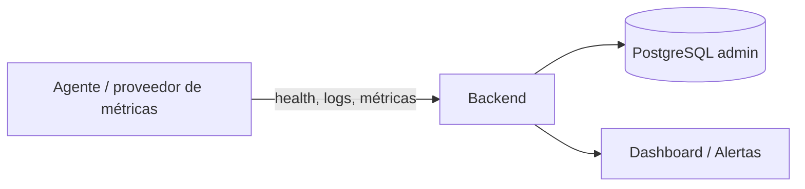

# OPERATIONS.md — Operaciones de EVAS Admin

**Estado:** Borrador inicial.
**Documentos relacionados:** [`DOCKER_STANDARD.md`](./DOCKER_STANDARD.md),
[`SECURITY.md`](./SECURITY.md), [`POSTGRES_EXISTING_INSTANCE.md`](./POSTGRES_EXISTING_INSTANCE.md).

## 1. Ámbito

Describe cómo se opera EVAS Admin y las instalaciones EVA que gestiona:
backups/restauración, actualizaciones y rollback, logs, monitoreo, alertas y
respuesta a incidentes.

> En el MVP, las operaciones Docker se ejecutan con **adaptador simulado** (no
> producen cambios reales). La ejecución real requiere autorización humana y un
> agente restringido ([`DECISIONS.md`](./DECISIONS.md#adr-007)).

## 2. Backups

### 2.1 Qué se respalda

- Base administrativa de EVAS (metadatos).
- Bases de negocio de cada cliente (según ADR-012, [POR VERIFICAR]).

### 2.2 Objeto `BACKUP`

`id`, `database_record_id`, `type` (`full`/`incremental`), `status`, `started_at`,
`finished_at`, `location_ref` (referencia lógica), `size_bytes`.

### 2.3 Política (propuesta)

| Aspecto | Propuesta |
|---------|-----------|
| Frecuencia | Diaria para bases de negocio; diaria para la administrativa. |
| Retención | 30 días [PROPUESTA]. |
| Verificación | Comprobación periódica de integridad del backup. |
| Antes de actualizar | Backup obligatorio previo a cada actualización. |

### 2.4 Flujo de backup (operación tipada `request_backup`)

## 3. Restauración

- Requiere permiso específico `backups:restore` + confirmación + auditoría.
- Operación **destructiva**: exige ventana controlada y aviso.
- En MVP: simulada. En real: sólo vía agente autorizado.
- Verificación posterior con healthchecks.

## 4. Actualizaciones y rollback

### 4.1 Flujo de actualización

Ver [`ARCHITECTURE.md`](./ARCHITECTURE.md#72-actualización-controlada).
Pasos: validar versión aprobada → registrar solicitud → backup según política →
ejecutar vía agente → esperar healthchecks → registrar resultado.

### 4.2 Rollback

- Documentado cuando sea técnicamente posible.
- Requiere backup previo y versión anterior disponible.
- Auditado como operación independiente.

## 5. Logs

| Aspecto | Política |
|---------|----------|
| Formato | Estructurado (JSON), saneado |
| Rotación | Por tamaño y número de archivos |
| Retención | 30 días [PROPUESTA] |
| Secretos | **Nunca** en logs |
| Acceso | Restringido por permiso `operations:read` |

Los logs mostrados en el panel corresponden a las instalaciones, **saneados** y
con tamaño limitado.

## 6. Monitoreo

Por instalación/servicio se muestra: estado, healthcheck, versión deseada e
instalada, última comprobación, último despliegue y (si hay métricas fiables)
CPU/RAM.

## 7. Alertas

| Tipo | Disparador | Severidad |
|------|-----------|-----------|
| `subscription_expiring` | X días antes del vencimiento | warning |
| `subscription_expired` | Vencimiento alcanzado | critical |
| `health_degraded` | Healthcheck fallido | critical |
| `backup_missing` | Sin backup según política | warning |
| `operation_failed` | Operación fallida | warning |

Canal de notificación [POR VERIFICAR]. Las alertas se registran y pueden
reconocerse/resolverse desde el panel.

## 8. Runbooks

### 8.1 Incidente de salud de una instalación
1. Consultar `/installations/{id}/health` y logs saneados.
2. Si procede, `POST /installations/{id}/health-check`.
3. Si se autoriza, `POST /installations/{id}/restart`.
4. Registrar y comunicar; escalar si persiste.

### 8.2 Vencimiento de suscripción
1. Revisar alerta `subscription_expiring/expired`.
2. Contactar al cliente (Atención al cliente).
3. Renovar (`POST /subscriptions/{id}/renew`) o suspender manualmente si hay
   política aprobada.
4. **No** suspender/borrar instalaciones automáticamente sin política.

### 8.3 Fuga de secreto (sospecha)
1. Contener y revocar tokens.
2. Revisar auditoría.
3. Rotar secretos afectados.
4. Documentar en [`SECURITY.md`](./SECURITY.md).

## 9. Entornos

| Entorno | Uso | Notas |
|---------|-----|-------|
| Local | Desarrollo | BD local aislada o mock; **no** tocar la instancia existente |
| Staging | Pruebas | [POR VERIFICAR] |
| Producción | Operación real | Autorización explícita requerida |

> El desarrollo local **no** debe conectarse al PostgreSQL existente sin
> autorización ni usar contenedores preexistentes.

## 10. Pendientes de confirmación

1. Herramienta/almacenamiento de backups. [POR VERIFICAR]
2. Retención definitiva de logs y backups.
3. Canal de notificación de alertas.
4. Existencia del agente real y su contrato de autorización.
