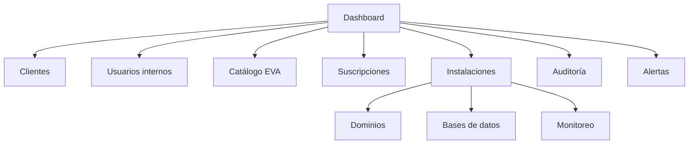

# UX_DESIGN_SYSTEM.md — Sistema de diseño de EVAS Admin

**Estado:** Basado en Apple HIG + tokens exactos de marca HAPMED (tomados del
manual técnico del sitio, `PaginaHapmed/site/assets/css/styles.css` y los SVG).
**Documentos relacionados:** [`PRODUCT_REQUIREMENTS.md`](./PRODUCT_REQUIREMENTS.md),
[`ARCHITECTURE.md`](./ARCHITECTURE.md), [`DECISIONS.md`](./DECISIONS.md).

## 0. Fuentes y alcance

1. **Apple Human Interface Guidelines (HIG)** — skill `apple-design-skill`. Se
   aplican como **lenguaje de diseño** a una **aplicación web** (SvelteKit), no
   como APIs SwiftUI/UIKit. HIG describe **intención de diseño**, no nombres de
   API.
2. **Identidad de marca HAPMED** — activos en [`../../brand/`](../../brand/) y
   tokens exactos del sitio corporativo.
3. **Web corporativa** — <https://www.hapmed.qzz.io/>.

> Los valores de color, tipografía, radios, sombras y easing de §2/§3 son los
> **tokens exactos** publicados en el sitio de HAPMED. No son propuestas.

## 1. Identidad de marca

- **Marca:** HAPMED — «**H**acer **A**utomatizaciones **P**ara **M**enos
  **E**strés **D**iario».
- **Claim (EN):** *Engineering what comes next.* · **Subclaim (ES):**
  *Tecnología que simplifica tu día.*
- **Símbolo:** mascota (mono con gafas) con peto en degradado azul→turquesa.
- **Logotipo:** palabra **HAPMED** en sans-serif, negro `#1d1d1f`, bold,
  `letter-spacing` amplio.

### 1.1 Activos de marca

| Activo | Uso previsto |
|--------|--------------|
| [`brand/logo-mark.png`](../../brand/logo-mark.png) | Símbolo/mascota en color (login, **onboarding**, estados vacíos). |
| [`brand/logo-mark-mono.png`](../../brand/logo-mark-mono.png) | Versión monocroma (fondos con poco contraste). |
| [`brand/logo-appicon.png`](../../brand/logo-appicon.png) | Icono de aplicación (PWA futura, accesos). |
| [`brand/favicon-64.png`](../../brand/favicon-64.png) | Favicon web. |
| [`brand/apple-touch-icon.png`](../../brand/apple-touch-icon.png) | Icono iOS/iPadOS al guardar en inicio. |
| [`brand/og-image.png`](../../brand/og-image.png) | Previsualización (Open Graph). |

**Reglas de uso (HIG · Foundations · Branding):**
- La marca **cede ante el contenido**; no repetir el logo por toda la interfaz.
- **Onboarding:** la mascota es la protagonista de la bienvenida (ver §7.1). Es
  el único lugar con presencia destacada del símbolo.
- Fuera del onboarding: logo en cabecera de la barra lateral y, de forma
  discreta, en estados vacíos.
- Usar la variante **mono** cuando el fondo no garantice contraste. No
  reencuadrar, recolorear ni deformar el símbolo.

## 2. Color — tokens exactos de marca

**Principios (HIG · Color):** un único acento para interactividad; estados con
color **+ icono + texto**; variantes claro/oscuro y alto contraste.

### 2.1 Base de marca (idénticos a la web HAPMED)

| Token | Valor (exacto) | Uso |
|-------|----------------|-----|
| `--bg` | `#fbfbfd` | Fondo de página (claro) |
| `--ink` | `#1d1d1f` | Texto/marca principal |
| `--ink-2` | `#6e6e73` | Texto secundario |
| `--ink-3` | `#8a8a8f` | Texto terciario / metadatos |
| `--line` | `rgba(0,0,0,0.08)` | Separadores y bordes |
| `--accent` | `#2e6bff` | Acento primario (acción) |
| `--accent-2` | `#00c2b8` | Acento secundario |
| `--brand-gradient` | `linear-gradient(135deg,#2e6bff,#00c2b8)` | Elemento firma |
| `--glass` | `rgba(255,255,255,0.55)` | Material de controles |
| `--glass-strong` | `rgba(255,255,255,0.72)` | Material reforzado |
| `--glass-border` | `rgba(255,255,255,0.7)` | Borde de material |
| `--radius` | `24px` | Radio principal |
| `--radius-sm` | `16px` | Radio secundario |
| `--container` | `1080px` | Ancho máximo de contenido |
| `--ease` | `cubic-bezier(0.22,0.61,0.36,1)` | Curva estándar |

### 2.2 Tema oscuro (HIG · Dark Mode)

Derivado del fondo oscuro de la imagen Open Graph (`#0b0c0e`, `#1b2340`) y del
texto secundario `#a7abb3`. Se aplica con `prefers-color-scheme` **o** con el
selector de tema manual (se soportan **claro y oscuro**).

| Token | Claro | Oscuro |
|-------|-------|--------|
| `--bg` | `#fbfbfd` | `#0b0c0e` |
| `--surface` | `#ffffff` | `#141518` |
| `--surface-2` | `#f2f2f7` | `#1b2340` |
| `--ink` | `#1d1d1f` | `#f5f5f7` |
| `--ink-2` | `#6e6e73` | `#a7abb3` |
| `--ink-3` | `#8a8a8f` | `#6e737c` |
| `--line` | `rgba(0,0,0,0.08)` | `rgba(255,255,255,0.10)` |
| `--accent` | `#2e6bff` | `#5b8cff` |
| `--accent-2` | `#00c2b8` | `#2fd6cd` |
| `--glass` | `rgba(255,255,255,0.55)` | `rgba(20,22,26,0.55)` |
| `--glass-strong` | `rgba(255,255,255,0.72)` | `rgba(20,22,26,0.72)` |
| `--glass-border` | `rgba(255,255,255,0.7)` | `rgba(255,255,255,0.12)` |

### 2.3 Colores de estado (HIG system colors)

Semánticos de estado, con variantes de alto contraste; **no** reinterpretados:

| Estado | Token | Nota |
|--------|-------|------|
| Correcto/Activo | `--green` | HIG Green |
| Atención/Degradado | `--orange` | HIG Orange |
| Crítico/Error | `--red` | HIG Red |
| Informativo | `--accent` | acento de marca |
| Desconocido/Neutro | `--ink-3` | gris |

Regla: `--accent` es **acción/interactividad**, no estado.

## 3. Tipografía — familia exacta de marca

- **Familia (exacta de la web):**
  `-apple-system, BlinkMacSystemFont, "SF Pro Display", "Segoe UI", Roboto, Helvetica, Arial, sans-serif`.
- Jerarquía por **tamaño + peso + color**; una sola familia.
- Evitar pesos light; preferir Regular/Medium/Semibold/Bold.

Escala (adaptación web de *text styles* HIG; usar `rem`) [PROPUESTA]:

| Estilo | Tamaño | Peso | Uso |
|--------|--------|------|-----|
| Large Title | 34px | Regular | Encabezado de página |
| Title 1 | 28px | Regular | Título de sección |
| Title 2 | 22px | Regular | Título de tarjeta |
| Title 3 | 20px | Semibold | Subtítulo |
| Headline | 17px | Bold | Encabezado de fila |
| Body | 17px | Regular | Texto e ítems de tabla |
| Callout | 16px | Regular | Texto de ayuda |
| Subheadline | 15px | Regular | Subtítulos |
| Footnote | 13px | Regular | Notas |
| Caption 1/2 | 12px/11px | Regular/Medium | Etiquetas y metadatos |

- El **wordmark** usa `--ink` con peso bold y `letter-spacing` amplio (como el
  sitio); no replicar ese peso en texto de UI.
- Escalado de texto hasta **200 %** sin pérdida de contenido (usar `rem`).

## 4. Materiales y profundidad (HIG · Materials)

- **Capa de contenido:** superficies sólidas (`--bg`, `--surface`, `--surface-2`).
- **Capa de controles/navegación:** barra lateral, barra de herramientas y menús
  usan los tokens `--glass*` (efecto translúcido: `backdrop-filter: blur()
  saturate()`), con **fallback opaco** y respeto a `prefers-reduced-transparency`.
- Material reforzado (`--glass-strong`) para elementos con mucho texto
  (barra lateral, popovers). No usar glass en la capa de contenido.

## 5. Movimiento (HIG · Motion)

- Curva estándar: `--ease` (`cubic-bezier(0.22,0.61,0.36,1)`).
- Duraciones: feedback 120–200 ms; transición de vista 250–300 ms.
- Respetar `prefers-reduced-motion` (desactivar no esencial).
- El movimiento nunca es el **único** canal de información.

## 6. Layout y navegación (HIG · Layout, Sidebars, Split views)

### 6.1 Shell: barra lateral adaptable

Se adopta el patrón **barra lateral adaptable** (HIG · Sidebars, estilo
`sidebarAdaptable`): un único control que se presenta como **barra lateral** en
ancho amplio y como **barra de pestañas** en ancho compacto, con un botón para
alternar.

| Contexto | Presentación |
|----------|--------------|
| Escritorio (≥1024px) | **Barra lateral** fija (leading) + área de detalle. |
| Tablet (640–1024px) | Barra lateral colapsable. |
| Móvil (<640px) | **Barra de pestañas** (secciones principales) con acceso a la barra lateral. |

- Máximo **dos niveles** de jerarquía en la barra lateral (HIG).
- Iconos familiares + etiqueta; permitir ocultar/mostrar la barra lateral.
- **Dividers finos** (1px) entre paneles.

### 6.2 Barra de herramientas (HIG · Toolbars)

- **Leading:** botón de barra lateral + título.
- **Center:** buscador y filtros.
- **Trailing:** **una** acción primaria prominente (acento de marca), separada
  de las secundarias.

### 6.3 Mapa de navegación

## 7. Componentes (mapeados a HIG)

### 7.1 Librería de iconos

**Decisión:** **Lucide** (`@lucide/svelte`) como equivalente web de SF Symbols.

| Criterio | Por qué Lucide |
|----------|----------------|
| Estilo | Trazo único, uniforme, geométrico — coherente con HIG/SF Symbols. |
| Integración | Paquete nativo Svelte (`@lucide/svelte`), componentes, tree-shaking. |
| Licencia | ISC/open source, uso comercial sin fricción. |
| Tamaño/color | Heredan `currentColor` y tamaño por props; encajan con tokens. |
| Cobertura | Amplia y con nombres estables (evita SVG sueltos). |

**Reglas:** no incrustar SVG sueltos ni bitmaps; usar el mismo set en toda la
app; tamaño y peso alineados con el texto; en la barra de herramientas, iconos
**sin bordes** (HIG · Toolbars).

> Alternativas consideradas: Iconify (cobertura mayor, más peso/config),
> Phosphor (estilo alternativo). Se documenta Lucide como elección; ver
> [`DECISIONS.md`](./DECISIONS.md#adr-018--librería-de-iconos-web).

### 7.2 Tabla de componentes

| Componente EVAS | Base HIG | Notas |
|-----------------|----------|-------|
| `AppSidebar` | Sidebars | Adaptable; 2 niveles máx.; colapsable. |
| `AppToolbar` | Toolbars | Leading/center/trailing; 1 acción prominente. |
| `DataTable` | Lists and tables | Encabezados descriptivos, orden, columnas redimensionables (desktop), elipsis en medio. |
| `FilterBar` + `SearchField` | Search fields | Búsqueda con estado en URL. |
| `Button` | Buttons | Estilos **prominent** (`--accent`), standard, **destructive** (`--red`), cancel; 1–2 prominentes/vista. |
| `ConfirmDialog` | Alerts / Sheets | Confirmación de acciones destructivas. |
| `Sheet` / `DetailDialog` | Sheets | Tareas acotadas con acción primaria. |
| `SegmentedControl` | Segmented controls | Periodo de plan; pestañas de detalle. |
| `StatusBadge` | Status | Color + **icono + texto**. |
| `ProgressIndicator` | Progress indicators | Operaciones en curso (deploy/upgrade). |
| `Gauge` | Gauges | CPU/RAM si hay métricas. |
| `EmptyState` | Layout / Patterns | Mensaje + acción; mascota discreta. |
| `Toast` / `InlineAlert` | Feedback | Sin detalles internos. |

**Reglas:** press state obligatorio; hit target ≥44×44 px; un solo botón
primario por vista, en el lado trailing.

## 8. Onboarding (HIG · Patterns · Onboarding)

La mascota es el elemento central de la **bienvenida**:

- Se muestra al primer acceso del usuario y en la creación inicial (si aplica).
- Explica en 2–3 pasos qué es EVAS Admin y qué puede hacer, con la mascota
  acompañando (no como decoración de fondo).
- Ofrece «Saltar» y «Empezar»; no bloquea el uso ni repite información.
- Con `--ink` sobre `--bg`, con acento de marca en la acción primaria.

## 9. Estados de UI (obligatorios por vista)

| Estado | Requisito |
|--------|-----------|
| Carga | Skeleton o indicador; nunca pantalla en blanco. |
| Vacío | Mensaje claro + acción; mascota discreta. |
| Error | Mensaje comprensible + reintento; **sin** detalles internos. |
| Éxito | Confirmación no intrusiva (toast). |
| Sin permisos | Explicación + acción alternativa. |

## 10. Accesibilidad (HIG · Accessibility)

- **Contraste (WCAG AA):** ≥ **4.5:1** en texto ≤17 px; ≥ **3:1** en ≥18 px o
  negrita; verificar en claro **y** oscuro y con alto contraste.
- **No depender del color** para transmitir estado.
- **Control** mínimo 44×44 px; foco visible siempre.
- **Escalado de texto** hasta 200 %.
- `prefers-reduced-motion` y `prefers-reduced-transparency` respetados.
- **Navegación por teclado** completa; `aria-*` correctos.
- Confirmación para acciones destructivas; evitar doble envío.

## 11. Implementación (SvelteKit + Tailwind)

- Tokenizar §2/§3 como **variables CSS** y exponerlas en `tailwind.config`
  (`theme.extend.colors`, `borderRadius`, `fontFamily`, `transitionTimingFunction`).
- **Modo claro y oscuro** por `class` (con `prefers-color-scheme` como valor
  inicial) y un conmutador de tema persistente.
- `--brand-gradient` para el elemento firma (botón primario, marca).
- Materiales `backdrop-filter` con prueba de rendimiento y fallback.
- Iconos vía `@lucide/svelte`; componentes accesibles con elementos nativos + ARIA.

## 12. Decisiones resueltas

1. **Valores:** exactos, tomados del manual del sitio (no propuestas). Ver §2/§3.
2. **Iconos:** Lucide (`@lucide/svelte`) — ver §7.1 y ADR-018.
3. **Tema:** claro **y** oscuro — ver §2.2 y ADR-015.
4. **Navegación:** barra lateral adaptable — ver §6.1 y ADR-016.
5. **Mascota:** presente en onboarding — ver §1.1/§8 y ADR-017.
