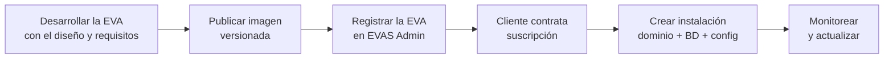

# Cómo funciona EVAS Admin — explicación sencilla («como peras y manzanas»)

## La analogía del edificio

Piensa en HAPMED como un **edificio de oficinas** y en cada **EVA** como un
**local/consultorio** distinto (cotizaciones, inventario, mantenimiento…).

- **EVAS Admin** es la **oficina de administración** del edificio. Ahí el
  personal de HAPMED hace papeleo y controla todo lo que pasa en los locales.
- Cada **cliente** (empresa) alquila uno o varios locales (una **suscripción**).
- Cada local alquilado y montado es una **instalación**: tiene una dirección
  (**dominio**), un cajón de documentos privado (**base de datos**) y una versión
  concreta (lo que se instaló).
- El **agente de operaciones** es el **conserje de la sala de máquinas**: solo
  abre o cierra interruptores (reiniciar, actualizar) **cuando la oficina se lo
  pide** y con instrucciones exactas. Nadie de la oficina entra a la sala de
  máquinas directamente.

## Qué hace EVAS Admin

1. **Registra** clientes, usuarios de HAPMED y catálogo de EVAs.
2. **Contrata** (suscripciones mensuales o anuales, con vencimientos y tiempo restante).
3. **Monta** instalaciones: cliente + EVA + versión + dominio + base de datos.
4. **Vigila** (monitoreo: estado, salud, logs saneados) y **avisa** (alertas).
5. **Actualiza** a versiones aprobadas, con respaldo previo y healthchecks.

## Cómo está hecho (las piezas)

| Pieza | Qué es |
|-------|--------|
| **Backend** (FastAPI + PostgreSQL) | El «cerebro»: reglas de negocio y API. |
| **Frontend** (SvelteKit) | El «mostrador»: lo que ve y usa el personal de HAPMED. |
| **Agente** (servicio restringido) | El «conserje»: única pieza que toca Docker. |
| **PostgreSQL existente** | Guarda los datos administrativos (una base; las de cada cliente van aparte). |

## El recorrido de una EVA (de la idea al cliente)

- **Peras**: programar y diseñar la app.
- **Manzanas**: el papeleo y la operación (clientes, cobros, dominios, backups,
  actualizaciones). EVAS Admin se encarga de las **manzanas**.

## Para el desarrollador de una EVA, en una frase

> Construye una **app web en contenedor**, con el **mismo diseño** que EVAS Admin,
> que **declare cómo se configura** y **exponga un healthcheck**; EVAS Admin se
> encargará de instalarla por cliente, darle dominio, base de datos, monitoreo y
> actualizaciones.

Sigue con [`REQUISITOS_EVA.md`](./REQUISITOS_EVA.md) y [`DISENO_EVA.md`](./DISENO_EVA.md).
